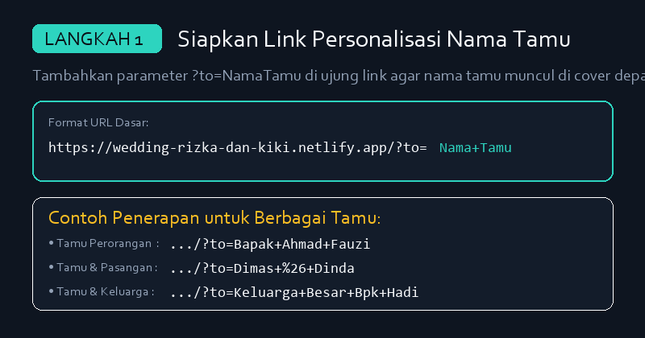
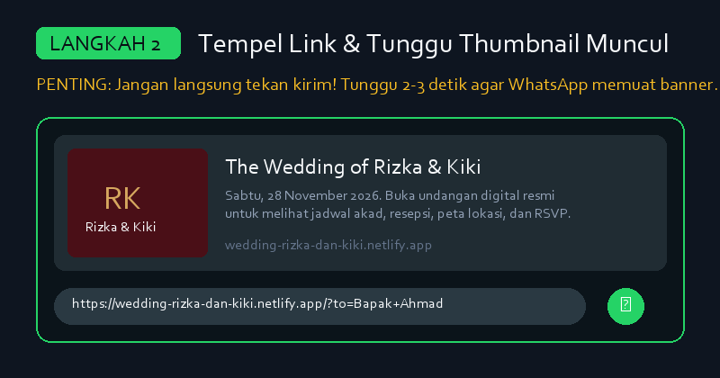
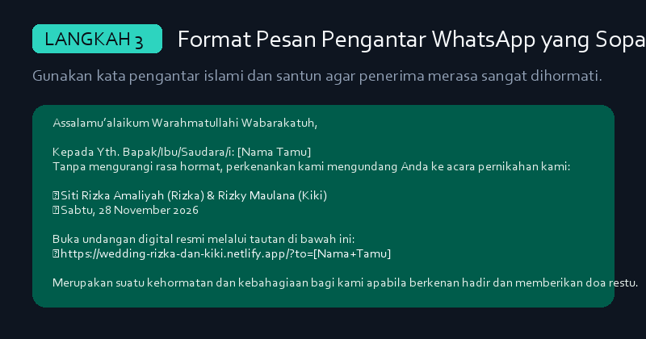
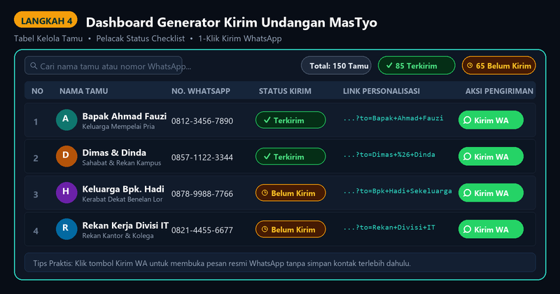

# 💌 Panduan Lengkap Cara Membagikan Undangan Pernikahan Online

### The Wedding of Siti Rizka Amaliyah (Rizka) & Rizky Maulana (Kiki)

Selamat atas pernikahan **Rizka & Kiki**! 💍  
Dokumen ini memuat panduan lengkap, langkah demi langkah, beserta gambar panduan untuk membagikan undangan pernikahan online resmi kepada keluarga, kerabat, sahabat, dan tamu undangan secara elegan, sopan, dan profesional.

---

## 🌐 Informasi Tautan Undangan Resmi

- **Tautan Utama**: [`https://wedding-rizka-dan-kiki.netlify.app/`](https://wedding-rizka-dan-kiki.netlify.app/)
- **Tools Kirim Otomatis**: [`https://mastyo-weddings.netlify.app/kirim-undangan`](https://mastyo-weddings.netlify.app/kirim-undangan)

---

## 🚀 Langkah demi Langkah Cara Membagikan Undangan

### 📌 Langkah 1: Personalisasi Nama Tamu pada Link

Agar nama tamu muncul secara otomatis di sampul depan undangan (_"Kepada Yth. Bapak Ahmad Fauzi"_), tambahkan kode `?to=Nama+Tamu` di bagian paling belakang link undangan.



#### Contoh Penulisan Link:

| Jenis Tamu          | Contoh Format Link                                                       |
| :------------------ | :----------------------------------------------------------------------- |
| **Perorangan**      | `https://wedding-rizka-dan-kiki.netlify.app/?to=Bapak+Ahmad+Fauzi`       |
| **Tamu & Pasangan** | `https://wedding-rizka-dan-kiki.netlify.app/?to=Dimas+%26+Dinda`         |
| **Keluarga Besar**  | `https://wedding-rizka-dan-kiki.netlify.app/?to=Keluarga+Besar+Bpk+Hadi` |
| **Teman / Sahabat** | `https://wedding-rizka-dan-kiki.netlify.app/?to=Sahabat+Alumni+SMA`      |

> 💡 **Tips Spasi**: Gunakan tanda plus (`+`) atau `%20` sebagai pengganti spasi antar kata, dan gunakan `%26` untuk tanda dan (`&`).

---

### 📌 Langkah 2: Tempel Link di WhatsApp & Tunggu Thumbnail Muncul

Saat Anda menyalin dan menempelkan tautan ke kolom obrolan WhatsApp, **JANGAN LANGSUNG TEKAN KIRIM**.



1. Tempelkan tautan undangan di kolom ketik pesan WhatsApp.
2. **Tunggu 2 hingga 3 detik**.
3. Sistem WhatsApp akan memuat kotak **Pratayang Gambar (_Thumbnail Card_)** resmi pernikahan Rizka & Kiki (dengan foto banner burgundy emas).
4. Setelah gambar kartu muncul, barulah tekan tombol **Kirim (Send)**.

---

### 📌 Langkah 3: Gunakan Format Pesan Pengantar yang Sopan

Sebaiknya sertakan kalimat pengantar yang santun dan islami saat mengirimkan undangan melalui WhatsApp, Email, atau Media Sosial.



#### 📝 Draf Template Pesan (Tinggal Salin & Sesuaikan):

```text
Assalamu’alaikum Warahmatullahi Wabarakatuh,

Bismillahirahmanirrahim.
Dengan memohon rahmat dan ridho Allah Subhanahu Wa Ta'ala, tanpa mengurangi rasa hormat, perkenankan kami mengundang Bapak/Ibu/Saudara/i:

*Kepada Yth: [Nama Tamu]*

Untuk hadir dan memberikan doa restu pada hari bahagia pernikahan kami:

💍 Siti Rizka Amaliyah (Rizka) & Rizky Maulana (Kiki)

📅 Akad Nikah:
Sabtu, 28 November 2026 | Pukul 12.00 WIB

📅 Resepsi:
Jum'at - Sabtu Malam Minggu, 27 - 28 November 2026 (Jam Bebas)
📍 Kediaman Mempelai Wanita: Dsn. Krajan Rt01 Rw02 Desa Benelan Lor Kec. Kabat

Detail susunan acara, lokasi maps venue, hitung mundur, dan pengisian ucapan/RSVP dapat diakses melalui undangan digital resmi kami pada tautan berikut:
👉 https://wedding-rizka-dan-kiki.netlify.app/?to=[Nama+Tamu]

Merupakan suatu kehormatan dan kebahagiaan bagi kami apabila Bapak/Ibu/Saudara/i berkenan untuk hadir dan memberikan doa restu kepada kami.

Atas perhatian dan doa restunya, kami ucapkan terima kasih.
Wassalamu’alaikum Warahmatullahi Wabarakatuh.

Kami yang berbahagia,
Rizka & Kiki
```

---

## ⚡ Cara Praktis: Menggunakan Tools Generator Kirim Undangan MasTyo Wedding

Bagi Anda yang ingin mengirimkan undangan ke puluhan atau ratusan tamu sekaligus tanpa repot mengubah link manual satu per satu, Anda dapat menggunakan alat bantu resmi dari MasTyo Wedding:

👉 **[https://mastyo-weddings.netlify.app/kirim-undangan](https://mastyo-weddings.netlify.app/kirim-undangan)**



### Keunggulan Tools Ini:

1. **Otomatis Membuat Link Tamu**: Cukup masukkan daftar nama tamu (bisa langsung salin daftar nama dari WhatsApp / Excel).
2. **1-Klik Kirim via WhatsApp**: Tersedia tombol langsung menuju aplikasi WhatsApp HP atau WhatsApp Web tanpa perlu menyimpan nomor telepon satu per satu.
3. **Penyusunan Teks Otomatis**: Template pesan pembuka dan penutup otomatis dirangkai rapi dengan nama masing-masing tamu.
4. **Pencatat Status Kirim**: Terdapat penanda centang agar Anda tahu tamu mana yang sudah dikirimi undangan dan mana yang belum.

---

## ❓ Pertanyaan yang Sering Diajukan (FAQ)

### Q: Mengapa saat saya tempel link, gambar thumbnail-nya belum keluar?

**A:** Pastikan koneksi internet stabil dan berikan jeda waktu **2–3 detik** setelah _paste_ sebelum menekan kirim. Jika nomor tersebut pernah dikirimi tautan sebelumnya, WhatsApp mungkin menyimpan memori lama (_cache_). Solusinya, tambahkan parameter nama tamu, contoh: `?to=NamaTamu` atau tambahkan `?v=1` di ujung URL.

### Q: Apakah tamu yang menerima undangan bisa mengirim ucapan dan RSVP?

**A:** Ya! Tamu dapat langsung mengisi ucapan dan konfirmasi kehadiran di kolom **Do'a & Ucapan**. Data tersebut langsung tersimpan secara permanen ke Google Sheets pengantin secara otomatis.

---

_Dibuat dengan ❤️ oleh [MasTyo Wedding](https://mastyo-weddings.netlify.app/)_
